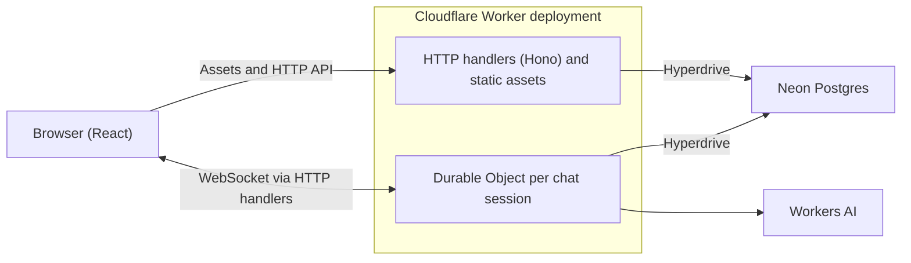

## MaoChat (migrated from node to Cloudflare Workers!)

Available at: [withworkers.chat.maowtm.org/](https://withworkers.chat.maowtm.org/)

This is the [chat.maowtm.org](https://chat.maowtm.org) project migrated to
run on a Serverless architecture using Cloudflare Workers with Workers AI.  The eventual goal is for this to replace the main instance to reduce maintenance burden.

### Architecture

- Workers Static Assets serves the Parcel-built frontend; Hono handles the API.
- Each session's Durable Object uses **WebSocket Hibernation** to keep idle
  connections open without staying active. Alarms run to retry failed messages.
- Neon stores chats, configuration, generation jobs, and RAG embeddings.
  Retrieval ranks vectors in memory rather than using a separate vector database.
- Workers AI provides chat generation and embeddings through a binding.
